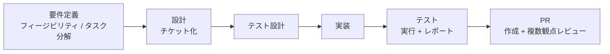

# 現場での活用例（参考）

発表者が実際の開発現場で使っている構成の紹介です。ライブデモでは扱いませんが、[チーム開発での運用構成（提案）](team-setup.md) をさらに進めた形として、質疑や締めの話題に使えます。

## 考え方

- 開発の**フェーズごとに特化した Skill** を作り、プラグインとして社内マーケットプレイスで共有する
- チケット・デザイン・システム全体の設計は**既存の SaaS で管理**し、Claude からは MCP で読み書きする
- 前のフェーズの成果物（レポート、チケット、試験項目）を次のフェーズの入力にして、工程をつなげる

## フェーズ別の Skill

| フェーズ | Skill の役割 | 成果物 |
| --- | --- | --- |
| 要件定義 | 実現可能性を調査する | フィージビリティレポート |
| 要件定義 | タスクを分解する | チケット単位に整理したタスク一覧 |
| 設計 | 分解したタスクごとに背景・スコープ・ゴール・対応内容を整える | チケット |
| テスト設計 | 設計をもとに必要な試験内容を整理する | 試験項目 |
| 実装 | 設計を満たすプロダクトコードとテストコードを書く | コード、テストコード |
| テスト | E2E を含むテストを自動で実行し、結果をまとめる | テストレポート |
| PR | プルリクエストを作る | PR |
| PR | 複数の観点でレビューする。観点ごとにサブエージェントを分け、コンテキストが混ざらないようにする | レビュー結果 |

## つないでいるサービス

| サービス | 主な用途 |
| --- | --- |
| Jira / Confluence | チケット、仕様・設計ドキュメント |
| Figma | デザイン |
| Miro | システム全体の設計の整理 |
| Google Drive | 資料の共有 |

各サービスの接続方法は [チーム開発での運用構成（提案）](team-setup.md) の「2. SaaS と MCP をつないだ推奨構成」を参照してください。

## このリポジトリとの対応

このリポジトリにも、同じ考え方の小さな版が入っています。

| 現場の構成 | このリポジトリでの例 |
| --- | --- |
| フェーズ特化の Skill | `.claude/skills/run-e2e`（テスト）、`.claude/skills/test-report`（レポート） |
| 複数観点のレビュー | `plugins/cc-demo-kit/agents/test-reviewer.md`（サブエージェント） |
| マーケットプレイスでの共有 | `.claude-plugin/marketplace.json` と `plugins/cc-demo-kit/` |
| 外部サービスとの接続 | `.mcp.json`（Playwright MCP） |
